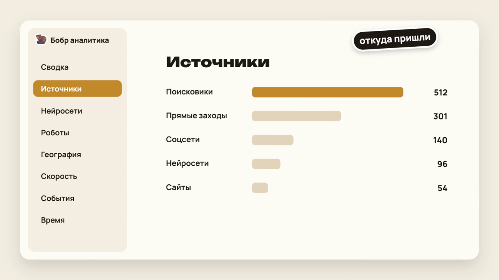
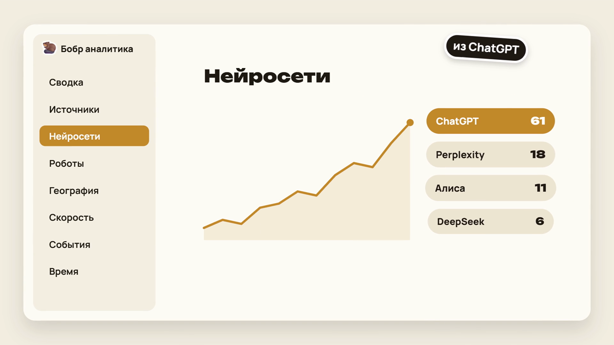
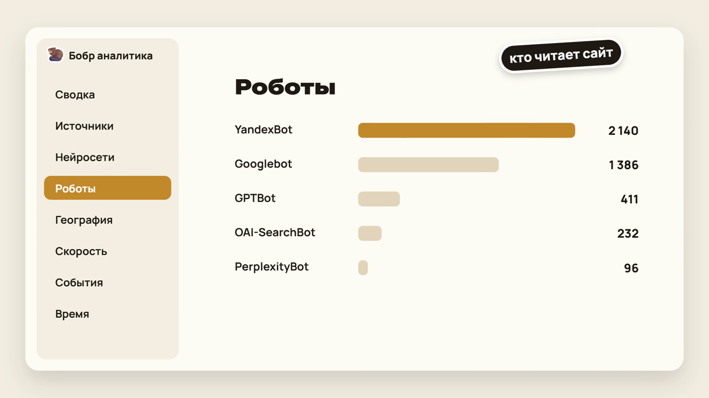
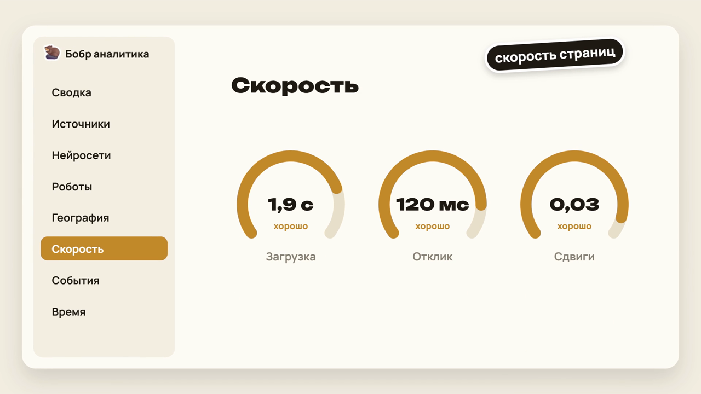
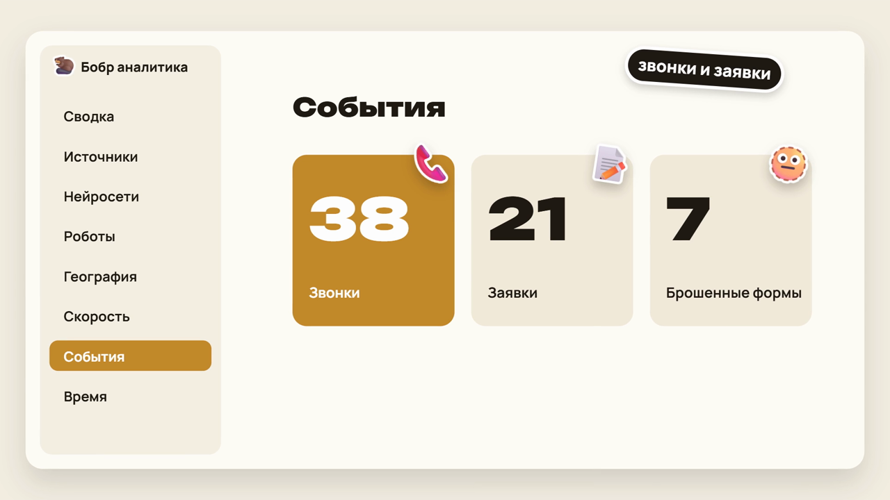
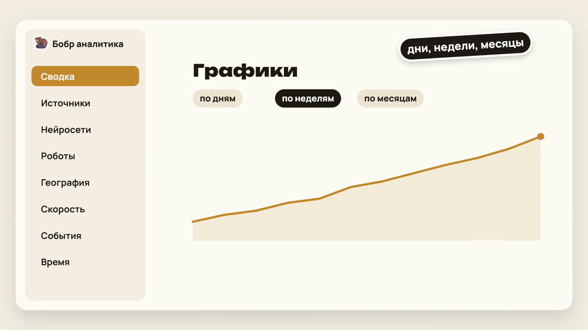
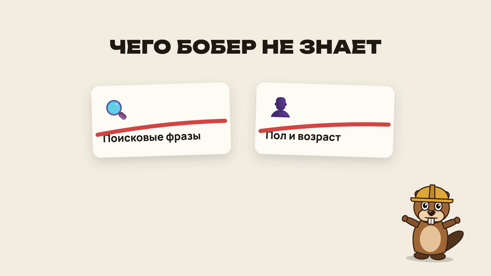

# Бобр аналитика


Своя статистика сайта на WordPress. Бесплатный плагин, который собирает посещаемость прямо в базе вашего сайта: без куки, без внешних сервисов и без зависимости от чужих серверов. Пока гиганты болеют, бобёр строит.

Автор: [Ekaterina Lopatina](https://lop-pa.dev), студия [LOP-PA.DEV](https://lop-pa.dev).

**[Скачать последнюю версию](../../releases/latest)** · [Сообщить об ошибке или предложить идею](../../issues) · [lop-pa.dev](https://lop-pa.dev)

## Ролик за 50 секунд

https://github.com/user-attachments/assets/49e219a6-f52a-4cdd-b378-dd9733e8f127

Полная версия 1080p лежит в разделе [Releases](../../releases/latest).

## Зачем

Привычные счётчики хранят ваши данные у себя. Если их сервис недоступен, вы теряете доступ к статистике, а визиты за эти дни могут пропасть совсем. Бобр аналитика пишет всё в базу вашего же сайта: пока работает сайт, работает и статистика. Плагин можно поставить рядом с Яндекс Метрикой или Google Analytics, он их не трогает.

## Что умеет

- **Сводка:** посетители, визиты, просмотры, отказы, глубина, время на сайте. Сравнение с прошлым периодом.
- **Графики по дням, неделям и месяцам:** посещаемость, типы источников, отказы, время, доли устройств, города, скорость, действия посетителей.
- **Источники:** поисковики, соцсети, сайты, прямые заходы, рекламные метки utm.
- **Нейросети:** переходы людей из ChatGPT, Perplexity, Алисы, DeepSeek и других, на какие страницы они ведут.
- **Роботы:** поисковые роботы и агенты нейросетей, что они читают, где получают ошибки 404.
- **Страницы:** страницы входа и выхода, время на странице, прокрутка, кто дочитал до конца.
- **География:** страны, регионы, города по офлайн-базе DB-IP.
- **Технологии:** устройства, системы, браузеры, ширина экрана.
- **Время:** тепловая карта по дням недели и часам.
- **События:** нажатия на телефон и почту, уходы по внешним ссылкам, отправленные и брошенные формы.
- **Скорость:** ответ сервера, первая отрисовка, LCP, INP и CLS по реальным посетителям.
- **Сейчас на сайте:** кто на сайте в последние 30 минут.
- Фильтры по источнику, устройству, городу и странице. Поиск по таблицам, листание и выгрузка в CSV.

### Как это выглядит

Цифры на картинках примерные.

| | |
|---|---|
|  |  |
| **Источники:** откуда пришли люди | **Нейросети:** кто пришёл из ChatGPT и других |
|  |  |
| **Роботы:** кто читает сайт | **Скорость:** реальные замеры у посетителей |
|  |  |
| **События:** звонки, заявки, брошенные формы | **Графики** по дням, неделям и месяцам |


## Чего не умеет



Честно о границах:

- **Поисковые фразы** показывают только сами поисковики, в их кабинетах для вебмастеров. Сайт эти фразы не получает.
- **Пол и возраст** большие сервисы берут из своих профилей пользователей по всему интернету. Плагин видит только ваш сайт и куки не использует, поэтому этих данных у него нет.
- **Посетитель узнаётся только в пределах суток.** Без куки нельзя отличить вернувшегося человека от нового через несколько дней. Посетители за неделю считаются как сумма посетителей по дням.

## Приватность

- Без куки и без localStorage.
- Айпи-адрес не хранится. Он используется в момент запроса, чтобы определить город, и сразу отбрасывается.
- Строка браузера не хранится, только устройство, система и браузер.
- Посетитель определяется по хешу из айпи, строки браузера, адреса сайта и случайной соли. Соль меняется раз в сутки, старая удаляется.
- Значения полей форм, номера телефонов и адреса почты не читаются и не отправляются.
- Плагин делает только один внешний запрос: скачивание базы городов с db-ip.com, и то по кнопке администратора.

## Требования

- WordPress 5.8 или новее.
- PHP 7.4 или новее.
- MySQL или MariaDB, как у любого WordPress.
- Для базы городов около 130 МБ свободного места на диске сайта. Без базы плагин тоже работает: страна и часовой пояс определяются по браузеру.

## Установка

1. Скачайте архив `bobr-analytics.zip` из раздела Releases на GitHub или с сайта [lop-pa.dev](https://lop-pa.dev).
2. В админке WordPress откройте Плагины, нажмите Добавить новый, затем Загрузить плагин и выберите архив.
3. Нажмите Установить, потом Активировать.
4. Готово: трекер подключится к страницам сам, вставлять код счётчика не нужно. Меню Бобр аналитика появится в админке слева.

Можно и вручную: распакуйте архив и положите папку `bobr-analytics` в `wp-content/plugins/`, затем активируйте плагин.

## Настройка

Всё в разделе Бобр аналитика, Настройки:

- **Кого не считать.** По умолчанию не считаются администраторы, редакторы и менеджеры магазина, когда они вошли на сайт.
- **Свои айпи-адреса.** Добавьте адреса, с которых заходите вы и ваша команда. Хранятся только в виде хешей.
- **Срок хранения.** Подробные записи хранятся 180 дней, потом удаляются по ночам. Суммы по дням без данных о людях хранятся бессрочно.
- **База городов.** Кнопка Скачать базу городов загрузит DB-IP City Lite (архив около 60 МБ). Файл ложится в `wp-content/uploads/bobr/` и закрывается от скачивания. Обновляйте раз в месяц той же кнопкой.
- **Учёт роботов и определение города** можно выключить.

### Если на сайте есть кэш страниц

Люди учитываются полностью: трекер работает в браузере. Роботы записываются на стороне PHP, поэтому заходы роботов на закэшированные страницы не попадают в статистику. Плагин сам показывает в настройках, есть ли на сайте кэш.

## Как считается

- **Визит:** просмотры одного посетителя с паузой меньше 30 минут. Новый внешний источник (поиск, соцсеть, нейросеть, сайт, метка utm) внутри визита начинает новый визит.
- **Отказ:** одна страница и меньше 15 секунд на ней.
- **Люди:** только те, у кого в браузере сработал JavaScript. Запросы с похожей на робота строкой браузера в людей не попадают.
- **Время на странице:** считается, только пока вкладка открыта перед глазами.
- **Ограничение частоты:** не больше 300 запросов от одного посетителя за 10 минут.

## Хранение данных

Таблицы с префиксом базы WordPress:

| Таблица | Что хранит | Срок |
|---|---|---|
| `bobr_visits` | визиты | по настройке, 180 дней |
| `bobr_hits` | просмотры страниц | по настройке |
| `bobr_events` | события и скорость | по настройке |
| `bobr_bots` | заходы роботов | по настройке |
| `bobr_daily` | суммы по дням без данных о людях | бессрочно |

Около 03:30 по времени сайта WP-Cron пересчитывает суммы за последние 3 дня и удаляет старые записи.

### Полное удаление

При удалении плагина данные остаются в базе, чтобы статистика не пропала при случайном удалении. Если нужно стереть всё:

1. Удалите таблицы `wp_bobr_visits`, `wp_bobr_hits`, `wp_bobr_events`, `wp_bobr_bots`, `wp_bobr_daily` (вместо `wp_` ваш префикс).
2. Удалите настройки `bobr_settings`, `bobr_db_ver`, `bobr_salt`, `bobr_geo_updated` из таблицы `wp_options`.
3. Удалите папку `wp-content/uploads/bobr/` с базой городов.

## Протокол трекера

Для разработчиков, которые хотят подключить трекер к сайту не на WordPress.

Трекер `assets/bobr.js` весит около 3 КБ и шлёт JSON через `navigator.sendBeacon` (тип `text/plain`), при неудаче через `fetch` с `keepalive: true` и `credentials: 'omit'`. Адрес приёма берётся из `window.bobr.u`, по умолчанию `POST /wp-json/bobr/v1/hit`. Сервер всегда отвечает `204 No Content`. Тело запроса не больше 4096 байт.

Общие поля:

| Поле | Тип | Что это |
|---|---|---|
| `t` | строка | тип запроса: `pv`, `lv`, `ev` |
| `id` | строка `[a-z0-9]{6,12}` | метка просмотра страницы, случайная на каждую загрузку, связывает `pv` с `lv` и `ev` |
| `p` | строка | путь страницы с параметрами: `location.pathname + location.search` |

### pv: просмотр страницы

| Поле | Что это |
|---|---|
| `ti` | заголовок страницы, до 200 символов |
| `r` | `document.referrer`, сервер оставляет только хост и путь |
| `w` | ширина экрана, сервер хранит группой |
| `tz` | часовой пояс браузера, например `Europe/Moscow` |
| `l` | язык браузера |
| `nf` | 1, если страница ответила 404 (`window.bobr.nf`) |

Метки `utm_source`, `utm_medium`, `utm_campaign`, `utm_term`, `utm_content` сервер берёт из параметров в `p`.

```json
{"t":"pv","id":"k3j9x0qa","p":"/catalog/?utm_source=chatgpt.com","ti":"Каталог","r":"https://yandex.ru/search/","w":1440,"tz":"Europe/Moscow","l":"ru-RU","nf":0}
```

### lv: уход со страницы

Отправляется, когда вкладка скрыта или страница закрывается. Может прийти несколько раз за один просмотр, сервер берёт максимум.

| Поле | Что это |
|---|---|
| `v` | сколько секунд вкладка была на виду |
| `s` | максимальная прокрутка, процент от высоты страницы |
| `m` | скорость: `ttfb`, `fcp`, `lcp`, `inp` в миллисекундах и `cls`. Любое поле может отсутствовать |

```json
{"t":"lv","id":"k3j9x0qa","p":"/catalog/","v":74,"s":88,"m":{"ttfb":310,"fcp":820,"lcp":1650,"inp":96,"cls":0.012}}
```

### ev: событие

| `k` | `n` | Когда |
|---|---|---|
| `out` | адрес без параметров | клик по ссылке на другой сайт |
| `tel` | нет | клик по ссылке телефона, номер не передаётся |
| `mail` | нет | клик по ссылке почты, адрес не передаётся |
| `fs` | название формы | форма отправлена |
| `fd` | название формы | в форму начали вводить, но ушли без отправки |

```json
{"t":"ev","id":"k3j9x0qa","p":"/contacts/","k":"out","n":"https://t.me/example"}
```

Чтобы подключить трекер к другому сайту, задайте адрес приёма перед скриптом: `window.bobr = {u: 'https://ваш-сайт/адрес-приёма', nf: 0}`. На сервере достаточно повторить ответ 204, разбор трёх типов запросов, хеш посетителя с суточной солью и правила визита и отказа.

## Структура

```
bobr-analytics.php           главный файл и настройки по умолчанию
includes/class-bobr-collector.php   приём запросов трекера, запись роботов
includes/class-bobr-util.php        разбор строки браузера, список роботов, источники
includes/class-bobr-geo.php         город по айпи
includes/class-bobr-mmdb.php        чтение базы DB-IP на чистом PHP
includes/class-bobr-db.php          таблицы
includes/class-bobr-cron.php        ночные суммы и чистка
includes/class-bobr-admin.php       дашборд и настройки
includes/class-bobr-report.php      запросы, период, сравнение, фильтры
includes/class-bobr-charts.php      графики SVG без библиотек
assets/bobr.js                      трекер
assets/admin.js, assets/admin.css   дашборд
```

## Лицензия

Плагин распространяется по лицензии GNU General Public License версии 2 или любой более поздней версии (GPL-2.0-or-later), как и сам WordPress. Полный текст в файле [LICENSE](LICENSE).

База городов DB-IP City Lite скачивается отдельно и распространяется по лицензии CC BY 4.0, ссылка на [DB-IP](https://db-ip.com) выводится в настройках плагина.

## Автор

[Ekaterina Lopatina](https://lop-pa.dev), студия [LOP-PA.DEV](https://lop-pa.dev): сайты, боты, автоматизация и SEO.
